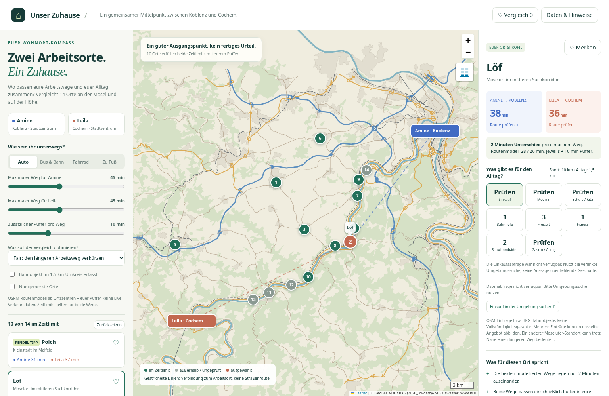

# Unser Zuhause – Wohnortvergleich Koblenz / Cochem

Interaktive Karte für faire Arbeitswege zwischen Koblenz und Cochem.

**Website:** https://amiiinoxy.github.io/ZuHause/

**Lahntal-Kartenprojekt:** https://amiiinoxy.github.io/ZuHause/Lahntal/ – eigene Unterseite mit Kartenvorschau, Druck-PDF, Quellen und ZIP-Download der Prüfungsabgabe. Die Dateien unter `Lahntal/` stammen aus der Abgabe `a656c4b`; das vollständige QGIS-Paket bleibt auf `abgabe-lahntal-2026`. Beide Websites werden über `wohnortvergleich` veröffentlicht.

GitHub Pages veröffentlicht den Branch `wohnortvergleich` aus dem Ordner `/(root)`. Für die kostenlose GitHub-Adresse bleibt **Custom domain leer**; es wird keine CNAME-Datei benötigt. Nach der Umbenennung des Repositorys zu `ZuHause` wurde die Karte am 28.10.2026 aus diesem Branch erfolgreich veröffentlicht. Der Branch `abgabe-lahntal-2026` enthält die separate Prüfungsabgabe und ist nicht die Quelle dieser Wohnortkarte.

Enthalten sind 14 mögliche Wohnorte, Auto-/Rad-/Fußwegmodelle zu beiden Stadtzentren, separat verlinkte Bus-/Bahn-Fahrplansuche, Favoriten und ein Vergleich von bis zu vier Orten. Autobahnen, Bundes-/Landesstraßen, Bahnstrecken, Wald und Ortslagen lassen sich über den Ebenenschalter rechts oben ein- und ausschalten. Fitnessstudios und benannte Bäder haben eigene Kategorien und einen Suchradius von 10 km Luftlinie; der sonstige Alltagsradius beträgt 1,5 km.

## Daten und Grenzen

- Arbeitswege: gespeicherte OSRM-/FOSSGIS-Routenmodelle; keine aktuellen Verkehrs- oder Fahrplandaten. Ausgangs- und Zielpunkte sind angenäherte Ortszentren. Ein frei einstellbarer Puffer kommt auf beide Wege hinzu.
- „Fair“ minimiert den längeren der beiden Arbeitswege, danach deren Summe; alternative Gewichtung 70:30 zugunsten eines Partners. Die Sortierung trifft keine Aussage über Ruhe, Wohnqualität, Preise oder konkrete Objekte.
- Infrastruktur: OpenStreetMap-Einträge über Overpass. Erfolgreich geladen wurden Freizeit-/Fitness-/Bad-Einträge und Teile der Medizin-/Alltagsangebote. **Einkaufs- und Bildungsdaten konnten nicht geladen werden.** Dort bietet die Oberfläche eine Umgebungssuche; fehlende Abfragen werden nicht als null Geschäfte oder null Schulen ausgegeben. Medizin zeigt lediglich einen Teilbestand mit Zahnarzt-Einträgen.
- Die 16 erfassten Fitnessstudio-Einträge und neun benannten Bäder im gemeinsamen Suchraum sind keine Zusicherung von aktuellem Betrieb oder öffentlichem Zugang. Saisonale Freibäder sind enthalten; private Gartenpools werden nicht angezeigt. Einträge gleicher Kategorie mit gleichem Namen innerhalb 120 m wurden zusammengefasst. Tarife, Öffnungszeiten und individuelle Verfügbarkeit bitte beim Anbieter prüfen.
- Kartengrundlage: © GeoBasis-DE / BKG (2026), DLM250, Datenlizenz Deutschland – Namensnennung 2.0, https://www.govdata.de/dl-de/by-2-0. Verwendete WFS-Objekte: AX_Strassenachse, AX_Bahnstrecke, AX_Bahnverkehrsanlage, AX_Wald und AX_Ortslage. Die Bahnobjekte weisen nicht automatisch aktive Personenverkehrshalte nach. Quelle: https://sgx.geodatenzentrum.de/wfs_dlm250
- Flüsse: Wasserwirtschaftsverwaltung RLP, Gewässernetz 2017, CC BY 4.0; https://geodienste-wasser.rlp-umwelt.de/geoserver/gewaesser/wfs
- POI-/Routingdaten: © OpenStreetMap-Mitwirkende, ODbL; https://www.openstreetmap.org/copyright. Routing: https://routing.openstreetmap.de/. Recherche und Verarbeitung: 27.10.2026; das Aktualitätsdatum einzelner Einrichtungen ist unbekannt.
- Leaflet 1.9.4: BSD-2-Clause, vollständiger Lizenztext liegt bei und ist in der HTML eingebettet. Keine Bildressourcen oder Schlüssel nötig. Die optionale Online-OSM-Karte benötigt Internet; Vektorkarte und Vergleich sind vollständig eingebettet.

## Nutzen und weiterbearbeiten

Direkt den Browser-Link öffnen oder das Repository als ZIP herunterladen und `index.html` lokal im Browser öffnen. `Wohnen/index.html` enthält dieselbe Anwendung. Beide Dateien sind eigenständig. Filter und Favoriten werden nur im jeweiligen Browser gespeichert; es gibt keine Anmeldung und keine Tracking-Skripte. Umgebungssuchen/Fahrpläne und die optionale Onlinekarte kontaktieren nach dem Aufruf externe Anbieter.

Neu erzeugen mit `python Wohnen/erstellen.py` (Python-Standardbibliothek). Der Generator verwendet die bereits aufbereiteten Daten in `Wohnen/recherche` und schreibt beide HTML-Dateien. Die erstmalige Datenrecherche enthielt externe Abfragen; deren fehlgeschlagene Kategorien sind oben dokumentiert.

Ruhiges Wohnen, Hochwasser/Starkregen, Miete/Kaufpreise, Internetversorgung, Kita-/Schulplätze, Ärzteaufnahme, Parken und Barrierefreiheit sind an einer konkreten Adresse zu prüfen. Die Karte ersetzt diese Objektprüfung nicht.
